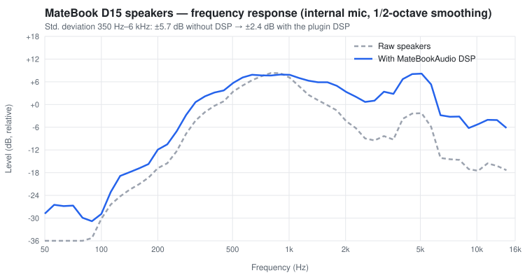

# MateBookAudio

macOS audio driver for laptops using **Intel Sound Open Firmware (SOF) + Everest ES8336** —
built for the Huawei MateBook D15 2020 (Comet Lake, board BOHB-WAX9).

These machines have no HDA codec: audio goes through the Intel cAVS DSP and an I2S codec on
I2C. AppleALC cannot drive that, so Hackintosh users usually fall back to USB or Bluetooth audio.
MateBookAudio drives the whole path itself:

| | |
|---|---|
| Speakers | ✅ with a measured EQ / virtual bass / limiter DSP |
| Headphones (hot-plug) | ✅ shown as *Headphones* in Sound settings |
| Internal microphone (DMIC) | ✅ |
| Headset microphone | ✅ shown as *External Microphone* when a 4-pole headset is plugged in |
| Volume, mute, sleep / wake | ✅ |
| Calls (FaceTime, Zoom… with Apple voice processing / echo cancellation) | ✅ |

Tested on **macOS Tahoe 26.7.1** and **macOS Sonoma 14.8**.



## How it works

```
CoreAudio ── MateBookAudio.driver (HAL plugin, DSP, jack/mic logic)
                 │  shared DMA buffers + UserClient
             MateBookAudio.kext ── Intel cAVS DSP running SOF (IPC3) ── SSP0 (I2S) ── ES8336
                 │                                                                      │
                 └──────────── I2C through VoodooI2C (ESSX8336) ────────────────────────┘
```

- **Kext** — loads the SOF firmware and topology into the DSP, builds the playback (SSP0),
  headset-capture (SSP0 RX) and DMIC pipelines over IPC3, programs the ES8336 over I2C and
  switches the speaker amplifier GPIOs.
- **HAL plugin** — a CoreAudio AudioServerPlugIn that maps the DMA ring buffers, runs the output
  DSP, follows the headphone jack and the headset mic, and recovers the DSP after sleep.
- **Boot script** — a LaunchDaemon that initialises the DSP at boot and selects speakers or
  headphones from the jack state.

The full write-up (register values, bugs, calibration) is in [docs/AUDIO.md](docs/AUDIO.md).

## Requirements

- macOS 14 Sonoma or later — tested on Tahoe 26.7.1 and Sonoma 14.8. OpenCore, SIP may stay enabled.
- [VoodooI2C](https://github.com/VoodooI2C/VoodooI2C) loaded (the codec sits on the same I2C
  controller as the trackpad).
- Xcode Command Line Tools to build.

## Install

1. Build the kext (or take it from the [releases](../../releases)):
   ```bash
   make -C kext            # → kext/MateBookAudio.kext
   ```
   Add it to `EFI/OC/Kexts/` and to `config.plist` → `Kernel > Add` **after VoodooI2C**,
   remove AppleALC, then reboot.
2. Install the plugin, `matebook_ctl` and the boot LaunchDaemon:
   ```bash
   sudo install/install.sh            # uninstall: sudo install/install.sh uninstall
   ```

For a ready-made MateBook D15 EFI, see
[huawei-matebook-d15-hackintosh](https://github.com/OctoDevStudios/huawei-matebook-d15-hackintosh).

## Changelog

**v1.1.0**
- The HAL clock now follows the real DMA position of the card instead of a free-running host
  clock. Speaker → mic latency is now fixed (~37 ms) instead of drifting between ~10 and
  ~350 ms, which broke echo cancellation: calls using Apple voice processing sounded wrong.
- The mic is read at a fixed offset from playback (re-measured if capture restarts).
- Denormals flushed in the IO cycle (high CPU use while the DSP filters decay to silence).
- Fixed a boot-time deadlock with VoodooI2C that could freeze the trackpad.
- Tested on macOS Tahoe 26.7.1.

**v1.0.0** — first release (Sonoma).

## Other laptops

Other machines with SOF + ES8336 (Chuwi, Infinix, some Huawei/Honor models…) need a few
board-specific values changed — PCI ID, amplifier GPIO pads, SSP port, headset-mic input,
firmware/topology. See [docs/PORTING.md](docs/PORTING.md). Reports and pull requests for other
models are welcome.

## Debugging

```bash
make -C tools && sudo tools/matebook_ctl status
log stream --predicate 'eventMessage CONTAINS "MateBookAudio"'
```

More commands in [docs/AUDIO.md](docs/AUDIO.md#5-debugging).

## License

- Code: [MIT](LICENSE).
- `kext/MateBookAudio/Firmware/` (`sof-cml.ri`, `sof-cml-es8336-dmic2ch-ssp0.tplg`) are
  Sound Open Firmware binaries from [sof-bin](https://github.com/thesofproject/sof-bin), embedded
  in the kext, under the licence in [LICENSES/LICENCE.SOF-Intel](LICENSES/LICENCE.SOF-Intel)
  (BSD-3-Clause and others).
- The register sequences follow the Linux `sof_es8336` / `es8316` drivers.
